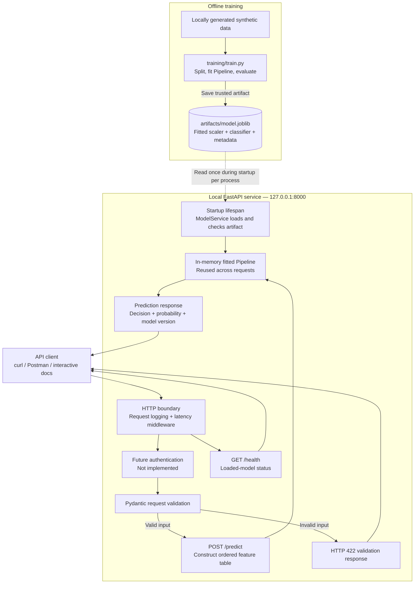

# Phase 0 — Synthetic Insurance Claims Model-Serving Platform

## High-level architecture

## Component boundaries and operational annotations

| Concern | Current location or behavior |
|---|---|
| Training | Offline script; never invoked by an API request |
| Artifact | Trusted local joblib file; excluded from Git |
| Model loading | FastAPI startup lifespan through ModelService |
| Input validation | Pydantic before the prediction handler |
| Feature compatibility | Loader checks names; prediction constructs ordered columns |
| Preprocessing | Fitted StandardScaler inside the saved Pipeline |
| Authentication | Future API-boundary control; not implemented |
| Logging | Startup logs and request method, path, status, duration |
| Sensitive input logging | Request bodies are not logged by our middleware |
| Model versioning | Artifact metadata and prediction response |
| Latency measurement | Middleware around server-side request handling |
| Health | Reports the running application's loaded model and version |
| Prediction | Uses the in-memory Pipeline without retraining |

## Scope and limitations

- This is one local service, not a distributed production platform.
- The authentication box is a future design annotation, not implemented middleware.
- Health and prediction routes are simplified in this HLD.
- The artifact is loaded once for each application process.
- Starting another worker or restarting the application loads another instance.
- The latency header does not measure client-network round-trip latency.
- The version label is not an immutable model registry.
- Input validation does not establish model accuracy or insurance suitability.
